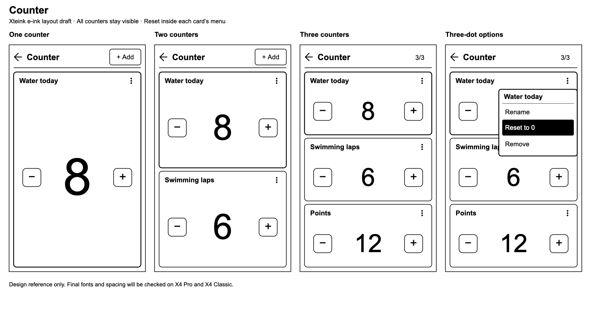

# Counter app plan

Counter is an offline Lua utility for up to three named counters on Xteink X4
Pro and X4 Classic. Keep the reference image's named cards, large value and
minus/plus controls, adapted to a monochrome e-ink screen. Reset belongs inside
each card's three-dot menu. This is an implementation plan dated 2026-10-25;
the replacement app has not been built or released.

[Editable vector layout](images/counter-layout.svg)

## Counter behavior

- Start a fresh installation with **Counter 1**, value **0**. Allow zero to three
  counters; removing the last one shows a large **Add counter** empty state.
- Each counter has a name and an integer value. Minus and plus change it by one.
  Allow negative values, bounded to -999999 through 999999. Reaching a bound
  leaves the value unchanged and shows a short limit message.
- **+ Add** in the header creates a counter through the firmware keyboard.
  Hide Add at three counters and show **3/3**. Button navigation includes an
  Add target only when a slot is available.
- Names are nonempty after trimming, limited to 48 UTF-8 bytes without control
  characters. Preserve valid Arabic text; measure and truncate displayed names
  without splitting UTF-8 characters. The full name remains available in Rename.
- Each card's **⋮** menu contains **Rename**, **Reset to 0**, and **Remove**.
  Reset asks **Reset [name] from [value] to 0?**, with **Cancel** selected first.
  Confirming changes only that counter and preserves its name. Remove also
  requires confirmation. Back dismisses either dialog without changing data.
- Keep version one focused on counting: fixed step one, names and persistence.
  Categories, color tags, history, goals and reset-all are outside this version.

## Layout for the Xteink display

All counters fit on one screen. Use black text, white cards, solid outlines and
a clearly marked selected card. Avoid pale fills, shadows, animation and a
floating button covering the third counter. The menu glyph has a large target,
even though its three dots are small. Keep an explicit touch Back control.

| Counter count | Portrait arrangement | Landscape arrangement |
| --- | --- | --- |
| One | One tall card, largest value | One wide card |
| Two | Two equal stacked cards | Two equal columns |
| Three | Three equal stacked cards, all fully visible | Three equal columns |

Use runtime `punri.get_bounds()` and `punri.get_metrics()` for the header,
bezel-safe margins and the Classic button-hint area. The 480 by 800 portrait
sketch is a design reference, not hardcoded application geometry. Start with
16 px side margins and 12 px gaps, increasing margins when the system requires
them. Reserve a small status area for unsaved changes or a retry action.

Aim for value heights near 160, 112 and 80 px for one, two and three portrait
cards. Shrink values to fit the full signed range without truncation. At narrow
landscape widths, put minus/plus below the value. Touch targets should be at
least 56 by 56 px, with menu rows at least 56 px high. Labels must use measured
font line heights and widths rather than guessed baselines.

The current Lua text API selects existing fonts without arbitrary scaling.
Implement the large numerals with a compact reusable geometric digit table
drawn through existing rectangle/line primitives, including a minus glyph.
This avoids loading a separate large bitmap for every value. The sketch's
system typeface is illustrative; validate the final digit shapes on the panel.

## Touch and physical controls

| Context | Touch on X4 Pro | Buttons on X4 Classic |
| --- | --- | --- |
| Change a value | Tap the card's minus/plus | Left/Right decrease/increase the selected counter |
| Select a counter | Tap its title or use its controls | Page Back/Page Forward select the previous/next card or Add target |
| Open options | Tap the card's three dots | Confirm opens the selected card's same three-dot menu |
| Add a counter | Tap header Add or empty-state Add | Select Add with the page buttons, then Confirm |
| Navigate a menu | Tap a visible row | Left/Right move up/down; Confirm selects |
| Cancel or exit | Visible Back or Cancel | Back dismisses the menu/dialog first, then exits from the main screen |

Handle `up`/`page_back` and `down`/`page_forward` as equivalent navigation
aliases. Act once on each logical button event. Current firmware delivers the
action on release; do not assume the callback provides press duration or add
hold-to-repeat. Define only `on_tap` for touch actions so compatibility
`on_touch` delivery cannot count a tap twice. Reset has no main-screen shortcut.

## Lua implementation and storage

Use a new `counter/` package and ID `counter`; keep the old `lifecounter` ID and
saved-data namespace reserved. Removing its source/catalog entry does not
uninstall an existing device package or erase its data. Do not silently import
game life points into the new utility. Keep repository history and attribution.

Use `main.lua` for lifecycle wiring, `model.lua` for bounded counter actions,
`ui.lua` for shared draw/hit-test rectangles and digit geometry, `input.lua` for
one touch/button action dispatcher, and `storage.lua` for validation and saving.
Load modules once during initialization. Use existing Lua/HAL interfaces; no
new C++ activity, SDK change, radio session, background task or framebuffer.

Persist a versioned text record containing only the ordered names, values and
selected position. Cap the encoded payload at 1024 bytes and reject oversized,
malformed or unsupported records without overwriting them. Encode names as
data, never as executable Lua. Read at most 1025 bytes to detect oversize files.
Use transactional `punri.write_file()` and check its boolean result;
`punri.save()` currently returns no success value.

Coalesce value saves after 750 ms without a change, with a maximum dirty window
of three seconds during sustained input. Flush pending changes when leaving
the app and best-effort in `on_exit()`. A failed write keeps the last good file
and the in-memory values, shows **Not saved — Retry**, and stops automatic
retries. An explicit exit after failure must offer Retry, Keep counting, or
Leave without saving. Abrupt power loss can lose the pending save window.
Keep normal automatic sleep enabled and verify sleep/wake persistence.

Allocate only three counter records and a reusable fixed collection of layout
and menu rectangles. Bounded Lua tables/strings are needed for editable names
and serialization; reuse geometry and avoid rebuilding modules or digit tables
on every draw. Measure actual Lua heap, internal free/largest block and PSRAM
when implemented; this plan makes no measured memory or speed claim.

Use the existing scheduled rendering path. Request an update for visible
changes and let the activity choose its normal fast refresh. Do not promise
rectangle-only panel refresh: the current Lua activity submits the framebuffer.
No idle redraw timer. Request a queued full refresh on entry and after a
provisional 20 value changes, then tune that interval from hardware ghosting
tests. The firmware may also redraw on input; measure actual refresh behavior.

## Source anchors

Paths below are relative to the firmware checkout; line numbers describe the
source inspected while planning and can move as concurrent work continues.

- `platformio.ini:382–475` defines the S3 X4 Pro and Classic panel/capability
  profiles; Pro has touch and Classic uses buttons.
- `src/activities/apps/lua/LuaRunner.cpp:1568–1590` exposes runtime layout
  metrics/bounds; `:2435–2455` exposes transactional writes with a boolean result.
- `src/activities/apps/lua/LuaRunner.cpp:1655–1672` shows that the key-value save
  API logs failure but supplies no Lua result.
- `src/activities/apps/lua/LuaAppActivity.h:97–140` delivers button-release
  events and both tap callbacks; `:178–199` uses fast/full framebuffer refresh.
- `apps/stopwatch/ui.lua:66–103` demonstrates runtime layouts and reusable
  geometry. `apps/README.md:243–279` describes the feature-gated firmware
  keyboard. Reuse its pattern and show a firmware-update message if unavailable.

## Implementation and acceptance

1. Build and exercise the pure model/storage modules: zero through three
   counters, signed bounds, add/remove order, rename cancellation, reset of
   one counter only, corrupt/oversized records and failed writes.
2. Implement responsive cards, digits and shared action dispatch. Test portrait
   and both landscape orientations in `x4-pro-simulator` and
   `x4-classic-simulator`, using long English/Arabic names and -999999 values.
   Check hit targets, visible focus, keyboard return and menu/dialog cancellation.
3. On **X4 Pro**, open Applications → Counter, create three counters, tap minus
   and plus rapidly, reset the middle one through ⋮, cancel a second reset,
   rotate, exit/reopen and sleep/wake. Only the intended value should change;
   all three cards and their controls must remain readable and accessible.
4. On **X4 Classic**, repeat using only physical buttons, including Add and all
   menu actions. Check that one release produces one change and selection stays
   visible after removing a card. Log refresh/heap behavior, test SD write
   failure, and inspect numeral ghosting before choosing the full-refresh interval.
5. No EPUB cache reset is needed. Use disposable new-app test data for corruption
   checks; retain old Life Counter installation/data. App implementation, version
   assignment, catalog listing, commits, pushes and App Store publication are
   separate work from this local removal and plan.

After an explicitly authorized catalog publication, verify the removal on a
device through Applications → App Store → refresh: Life Counter should no
longer appear for installation. A previously installed copy should still open
and retain its saved life total. Until publication, the remote store is unchanged.
